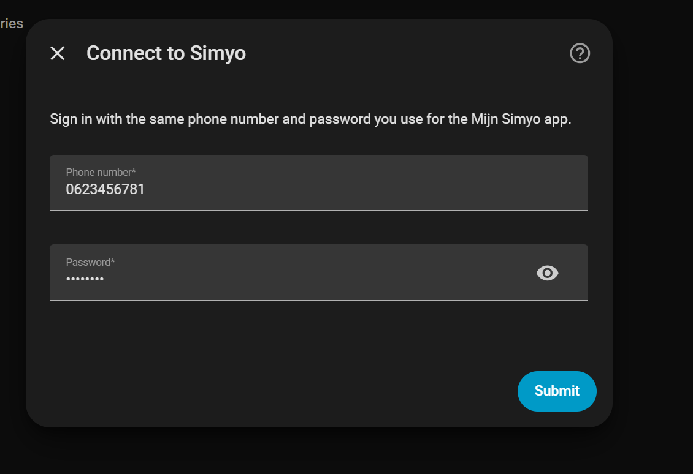
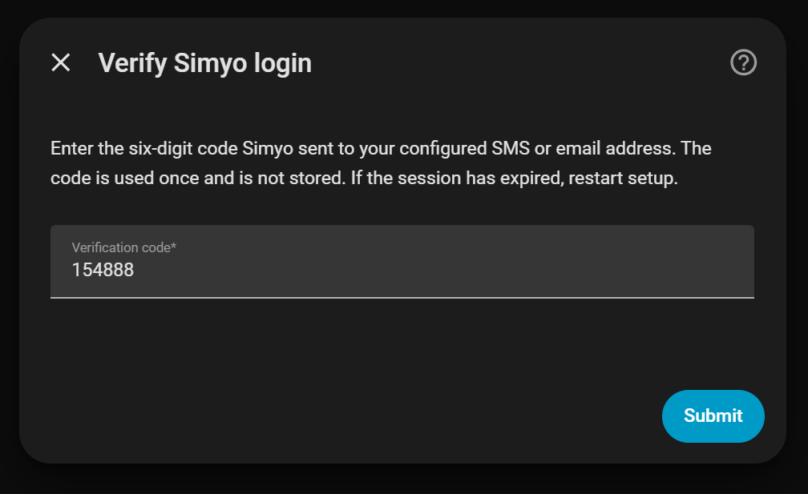
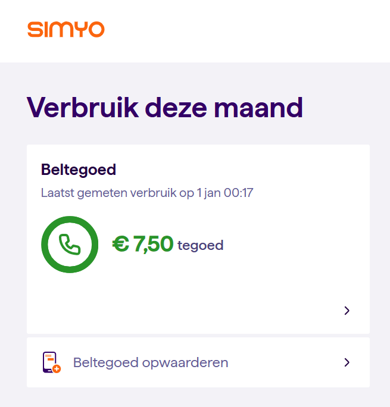
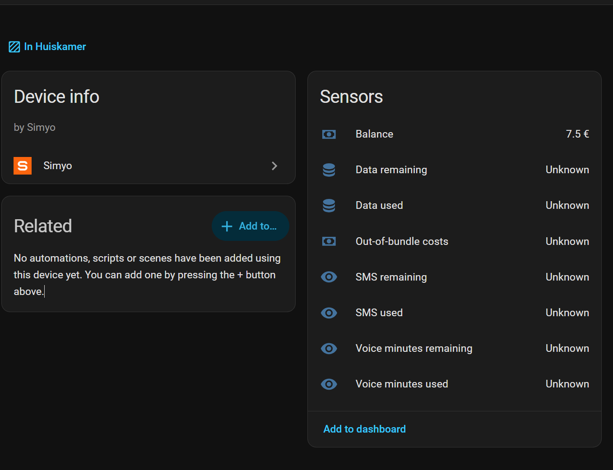

# Home Assistant Simyo integration

A custom Home Assistant integration that polls the [Mijn Simyo](https://mijn.simyo.nl/)
website API and exposes prepaid balance and available usage data as sensors.

## Screenshots

### Sign in to Mijn Simyo

Enter your phone number and Mijn Simyo password in Home Assistant.



### Two-step verification

If your account uses two-step verification, enter the code sent by Simyo.



### Prepaid balance in Mijn Simyo

The prepaid overview on the Simyo website shows the available credit.



### Sensors in Home Assistant

The integration exposes the prepaid balance in Home Assistant. Other sensors
may show `Unknown` when their values are unavailable or not yet mapped.



## Authentication and two-step verification

This fork implements the Mijn Simyo website login and OTP flow observed in
browser DevTools on 2026-10-30. Login, OTP verification and data retrieval all
use the same website session; website tokens are not sent to the app API.

1. `POST https://mijn.simyo.nl/auth/login` with `phoneNumber` and `password`.
2. A response with `user.mfaStatus == PENDING_VERIFICATION` opens a separate
   verification-code form. The restricted session token cannot fetch data.
3. `POST /api/post?endpoint=securityVerifyOtp` with `rememberMe: false` and
   `token: <six-digit code>`, using the **same private website cookie jar**.
4. The verified token comes from `result.token`. The client calls
   `POST /auth/update-token` with that token and `rememberMe: false`, exactly
   as the website does, to update the server-side website session.
5. Data uses `GET /api/get?endpoint=prepaidOverview` and
   `GET /api/get?endpoint=getAggregated`.

Home Assistant stores only the completed session token and allowlisted
authentication/routing cookies with its config entry. Pending challenge
cookies and OTP codes are never saved. No browser session is copied: these
cookies belong to the integration's own successful login.

The initial login and OTP request are kept in the same config flow, including
wrong-code retries. Expired challenges require a fresh login. Rate limits are
shown without automatically resending codes. The integration does not mark
the device as trusted or disable account security.

Home Assistant reuses the saved session after a restart. If Simyo expires
it and asks for 2FA again, reauthentication asks for the password and code.
English and Dutch forms are provided. Logs contain only fixed failure
categories and HTTP status, never response bodies or authentication values.

The original direct-app login probe remains available for diagnostics, but
the integration no longer mixes app endpoints with website authentication.

## Validation and limitations

The website request/response shapes above were inspected during a successful
real browser login. Automated tests cover the client and config-flow state
machine (using HA interface stubs), error redaction, token reuse, and actual
HTTP cookie continuity against a **local fake server**. They do not certify
an end-to-end Home Assistant login. The original live test confirmed OTP
verification but exposed rejection by the app data API. The corrected
website-only data flow still needs a live account check.

To run tests with Python 3.12+:

```sh
python -m pip install aiohttp voluptuous
python -m unittest discover -s tests -v
```

To validate the actual fork locally without installing Home Assistant:

```sh
python tools/verify_2fa.py
```

The live check prompts for credentials and the code locally (hidden), prints
only success/failure categories, and does not save tokens or responses. It
also checks data retrieval and restores the completed website session into
a new client to test restart behavior without sending another OTP.

This is unofficial and depends on private Simyo interfaces. The original
sensor platform probes likely field paths and exposes raw balance/usage
sections as entity attributes. Prepaid field mapping may need adjustment
even after authentication succeeds.

## Installation

1. Copy `custom_components/simyo` into your Home Assistant `config/custom_components/` directory.
2. Restart Home Assistant.
3. Go to **Settings → Devices & Services → Add Integration** and pick **Simyo**.
4. Enter your Simyo phone number (e.g. `0612345678`) and your Mijn Simyo password.
5. If requested, enter the latest six-digit verification code in the separate form.

## Sensors

| Sensor | Source endpoint |
| ------ | --------------- |
| Balance | `balance` |
| Data used / remaining | `usage` |
| Voice minutes used / remaining | `usage` |
| SMS used / remaining | `usage` |
| Out-of-bundle costs | `usage` |

Each sensor also publishes the full raw section payload as the `raw`
attribute, which is useful for debugging or for building template sensors on
fields that aren't yet mapped.

## Polling

The integration polls every 5 hours. There is no way to push from Simyo.

## Legacy app-login diagnostics

`python tools/probe_login.py` still probes the older direct app login and
prints a redacted response structure. It does not perform the website OTP
flow. Use `tools/verify_2fa.py` to test this fork's actual authentication.

## Local branding

Official Simyo icon and wordmark are bundled in `custom_components/simyo/brand/`
(normal and high-resolution PNGs), supported by Home Assistant 2026.3+. The
frontend can serve them locally without depending on an external brand lookup.

Image sources: [Simyo icon](https://www.simyo.nl/assets/favicon/apple-touch-icon.png)
and [Simyo wordmark](https://www.simyo.nl/assets/images/logo/simyo-yorange.svg).
Simyo names and images remain trademarks of their respective owner. This
unofficial integration is not affiliated with Simyo.
